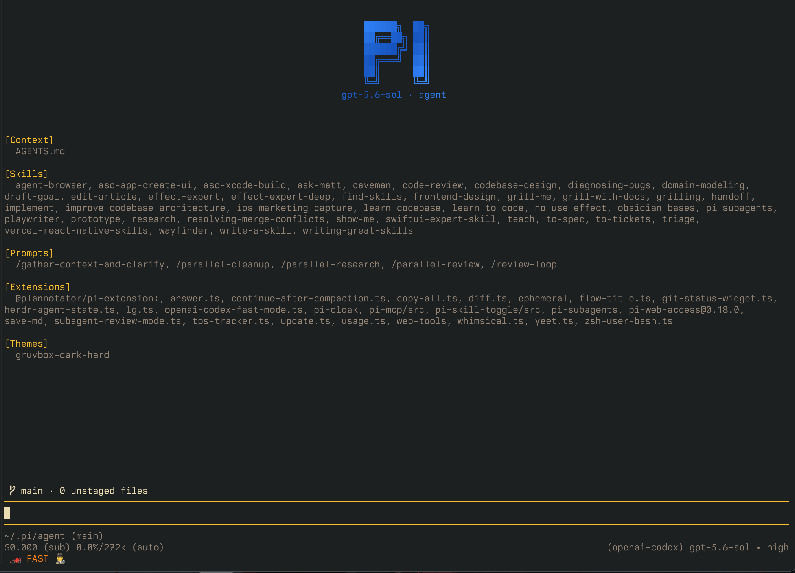

# 🥧 Pi Agent Setup

A personalized [Pi](https://pi.dev) AI coding agent configuration with custom extensions, commands, and themes.

> **Disclaimer:** This is a personal setup, not a recommended configuration. It's a reference for what's possible with Pi's extension system.



---

## Table of Contents

- [What is Pi?](#what-is-pi)
- [Getting Started](#getting-started)
- [Configuration (`settings.json`)](#configuration-settingsjson)
- [Codemode and MCP (`mcp.json`)](#codemode-and-mcp-mcpjson)
- [Thinking Levels / Effort](#thinking-levels--effort)
- [Extensions (Plugins)](#extensions-plugins)
- [Commands (Controllers)](#commands-controllers)
- [Pi 1.1 feature guide](docs/pi-features.md)
- [Verification](#verification)
- [Secret Masking (`cloak.json`)](#secret-masking-cloakjson)
- [Themes](#themes)
- [File Layout](#file-layout)

---

## What is Pi?

[Pi](https://pi.dev) is a terminal-based AI coding assistant with read, bash, edit, and write tools. It supports a powerful extension system that lets you add custom tools, commands, UI widgets, and event hooks — all via TypeScript files.

---

## Getting Started

1. **Install Pi 1.1.0 or newer:**

   ```sh
   npm install -g --ignore-scripts @earendil-works/pi-coding-agent
   ```

2. **Clone this repo** to `~/.pi/agent`:

   ```sh
   git clone https://github.com/makyinmars/pi-agent.git ~/.pi/agent
   ```

3. **Install dependencies:**

   ```sh
   cd ~/.pi/agent
   pnpm install
   npm --prefix extensions/web-tools install
   npm --prefix extensions/pi-skill-toggle install
   npm --prefix extensions/save-md install
   ```

4. **Configure direct Exa search:**

   ```sh
   cp ~/.pi/agent/web-search.example.json ~/.pi/web-search.json
   export EXA_API_KEY="your-exa-api-key"
   ```

   Persist `EXA_API_KEY` in your preferred shell or secret manager rather than committing it.
5. **Login:** Open Pi and run `/login` with your provider (e.g., Codex). Pick a model and you're ready.
6. **Verify authentication:** Run `pi auth check --provider openai-codex --model gpt-6.1-sol --json` (adjust the provider/model if you changed the defaults).
7. **Make sure that MCP connects:** Run `pi mcp list`. OpenAI Docs needs no sign-in. See [Codemode and MCP](#codemode-and-mcp-mcpjson).
8. **Header image (optional):** Install [`chafa`](https://hpjansson.org/chafa/) (`brew install chafa`) so the startup header can render `assets/void.png`. Without it, the header shows only the VOID lettering.

After adding, removing, or changing an extension or skill, run `/reload` in existing Pi sessions.

Personal skills are automatically discovered under `~/.agents/skills/`; no settings entry or copy into `~/.pi/agent/skills/` is needed. The canonical Railway skill is `~/.agents/skills/use-railway/SKILL.md`. Skill descriptions must be at most 1024 characters. A description-length warning under `[Skill conflicts]` does not mean there is a duplicate skill.

This checkout is aligned with Pi **1.1.0**. Local extensions use the current `@earendil-works/pi-*` package namespace and TypeBox 1.x API. Update Pi and installed Pi packages, then refresh model catalogs, with:

```sh
pi update --all
pi update --models
```

---

## Configuration (`settings.json`)

The main configuration file is `~/.pi/agent/settings.json`:

See the [Pi 1.1 feature guide](docs/pi-features.md) for tool-selection flags, terminal status, saved codemode images, project MCP overrides, and tool durations.

```json
{
  "lastChangelogVersion": "1.1.0",
  "defaultProvider": "openai-codex",
  "defaultModel": "gpt-6.1-sol",
  "defaultThinkingLevel": "medium",
  "defaultTools": [
    "+codemode",
    "+tool_search"
  ],
  "theme": "gruvbox-dark-hard",
  "packages": [
    "npm:pi-web-access@0.38.0"
  ],
  "hideThinkingBlock": false,
  "showCacheMissNotices": true,
  "cacheWarming": "streaming",
  "quietStartup": "header",
  "tuiMode": "fullscreen",
  "fullscreenExitOutput": "resume-hint",
  "fullscreenScrollbar": "auto",
  "terminal": {
    "showTerminalProgress": true
  },
  "markdown": {
    "mermaid": "streaming"
  }
}
```

| Key | Description |
| ----- | ------------- |
| `defaultProvider` | The AI provider to use (e.g., `openai-codex`, `google`, `anthropic`). |
| `defaultModel` | The default model ID (e.g., `gpt-6.1-sol`). |
| `defaultThinkingLevel` | Controls the reasoning/effort level. See [Thinking Levels](#thinking-levels--effort). |
| `defaultTools` | Adds `codemode` for scripts and `tool_search` for direct access to discovered tools. Keeps `read`, `bash`, `edit`, and `write`. |
| `theme` | The UI theme to load from `themes/`. |
| `packages` | NPM packages to load as Pi extensions. |
| `hideThinkingBlock` | When `true`, hides the model's thinking/reasoning output in the TUI. |
| `showCacheMissNotices` | Shows significant cache-miss notices, including cache warming, compaction, and branch-summary usage. |
| `cacheWarming` | `"streaming"` keeps eligible prompt caches warm during active runs. Refresh requests count toward usage. No requests run while idle. |
| `quietStartup` | `"header"` keeps the startup header (the VOID header from `flow-title.ts`) and hides the model scope line and loaded-resource listing. |
| `tuiMode` | Uses Pi's fullscreen TUI with a sticky editor/footer and independently scrollable transcript (Pi's default since 1.0.0). |
| `fullscreenExitOutput` | Restores the previous screen and prints only a resume hint when fullscreen Pi exits. |
| `fullscreenScrollbar` | Controls fullscreen transcript scrollbar visibility (`auto`, `always`, or `hidden`). |
| `terminal.showTerminalProgress` | Displays progress in terminal tabs that support OSC 9;4. |
| `markdown.mermaid` | Uses Pi's native Mermaid renderer (`off`, `final`, or `streaming`); no separate Mermaid extension is needed. |

You can also override settings per-launch with CLI flags:

```sh
pi --thinking high --model gpt-6.1-sol --provider openai-codex
```

---

## Codemode and MCP (`mcp.json`)

Pi 1.0 ships codemode and MCP support as built-in extensions; no adapter package is needed.

**Codemode** is enabled with `"defaultTools": ["+codemode", "+tool_search"]`. The model can write a JavaScript script that calls Pi's tools in parallel, filters large output before it reaches the context, and runs classifier and image models through `models`. Scripts find MCP tools with `searchTools()` and `describeNamespace()`. See Pi's [codemode docs](https://github.com/earendil-works/pi/blob/main/packages/coding-agent/docs/codemode.md).

`tool_search` discovers tools and declares them for direct calls. Codemode can also discover and call those tools without declaring them.

Image generation and classifiers need no separate extension. With a compatible provider signed in, ask Pi to generate an image or classify data. Codemode uses the provider credentials and includes usage in session totals. Codemode's `image()` saves generated images to temporary files and reports their paths. Ask Pi to copy images that you want to keep to a permanent location.

Automatic compaction uses the built-in continuation and recovery in Pi. Manual `/compact` does not inject a new user prompt or reread the entire session.

**MCP servers** are configured in `~/.pi/agent/mcp.json`:

| Server | Transport | Auth | State |
| -------- | ----------- | ------ | ------- |
| `openai-docs` | HTTP (`developers.openai.com/mcp`) | None | Enabled |
| `paper` | HTTP (`127.0.0.1:29979/mcp`) | None | Disabled; enable it in `/mcp` while the Paper app is running |

All servers use the default `codemode` exposure. Their tool schemas stay out of the prompt until `tool_search` loads them. Codemode scripts can call them without loading their schemas. Servers connect in the background and do not block the first prompt.

| Task | Command |
| ------ | --------- |
| Inspect, sign in, reconnect, enable, or change exposure | `/mcp` |
| Check every server from a shell | `pi mcp list` |
| Add a server | `pi mcp add <name> --url <url> --description "<what it offers>"` |
| Sign in or out | `pi mcp login <name>` / `pi mcp logout <name>` |

OAuth tokens are stored in `mcp-auth.json` and server logs in `mcp.log`; both are gitignored. Run `/reload` after editing `mcp.json` outside a session.

---

## Thinking Levels / Effort

Pi supports configurable reasoning/effort levels. Model and thinking selector changes are session-scoped unless explicitly saved with `Ctrl+S`.

| Method | How |
| -------- | ----- |
| **Config file** | Set `"defaultThinkingLevel"` in `settings.json` |
| **CLI flag** | `pi --thinking high` |
| **Selector** | Run `/thinking`; press `Ctrl+S` to save the choice globally |
| **Keyboard (TUI)** | Press `Shift+Tab` to cycle through levels interactively |

Valid levels (lowest to highest):

| Level | Description |
| ------- | ------------- |
| `off` | No reasoning tokens |
| `minimal` | Bare minimum thinking |
| `low` | Light reasoning |
| `medium` | Balanced |
| `high` | Deep reasoning |
| `xhigh` | Extra deep reasoning |
| `max` | Maximum reasoning budget |

---

## Extensions (Plugins)

Extensions are TypeScript files in `extensions/` that hook into Pi's lifecycle. They can register **tools**, **commands**, **UI widgets**, **event handlers**, and **flags**.

### Extension Overview

| File / Package | Type | Source | Description |
| ---------------- | ------ | -------- | ------------- |
| [`answer.ts`](extensions/answer.ts) | Command + TUI | dmmulroy | Interactive Q&A extractor — scans AI replies for questions, opens a TUI form to answer them |
| [`whimsical.ts`](extensions/whimsical.ts) | UI + Event hooks | dmmulroy | Replaces the working spinner with random funny status messages |
| [`herdr-agent-state.ts`](extensions/herdr-agent-state.ts) | Event hooks | Herdr | Reports agent state (working/blocked/idle) to Herdr via Unix socket |
| [`diff.ts`](extensions/diff.ts) | Command + Event hooks | custom | Tracks files changed during agent runs and opens them in Zed |
| [`copy-all.ts`](extensions/copy-all.ts) | Command | custom | Copies all conversation messages to clipboard |
| [`flow-title.ts`](extensions/flow-title.ts) | UI Header + Command | custom | VOID header from the Neovim dashboard (chafa image + lettering) with live model/project info |
| [`git-status-widget.ts`](extensions/git-status-widget.ts) | UI Widget | custom | Status bar widget showing current git branch and unstaged file count |
| [`tps-tracker.ts`](extensions/tps-tracker.ts) | UI Status + Events | custom | Tracks and displays tokens-per-second during model generation |
| [`openai-codex-fast-mode.ts`](extensions/openai-codex-fast-mode.ts) | Command + Shortcut + Event hooks | custom | Controls OpenAI priority service tier with `/fast`, a compact badge, and 🏎️ animation |
| [`usage.ts`](extensions/usage.ts) | Command | custom | Generates a detailed usage/cost report across 1/7/30/90 day windows |
| [`yeet.ts`](extensions/yeet.ts) | Command | custom | One-shot "add, commit, and push" with auto-generated commit messages |
| [`lg.ts`](extensions/lg.ts) | Command | custom | Summarizes unstaged git changes with per-file +/- line counts |
| [`zsh-user-bash.ts`](extensions/zsh-user-bash.ts) | Event hook | custom | Runs bash commands through zsh with proper shell configuration |
| [`pi-cloak/`](extensions/pi-cloak/) | Tool hook | dmmulroy | Masks secrets in read tool output using `cloak.json` patterns |
| [`pi-skill-toggle/`](extensions/pi-skill-toggle/) | Command + TUI | dmmulroy | Interactive TUI for toggling Pi skills on/off via frontmatter |
| [`save-md/`](extensions/save-md/) | Command | dmmulroy | Saves the latest assistant response as a Markdown file |
| [`web-tools/`](extensions/web-tools/) | Tool | dmmulroy | Local web fetch tool with SSRF protection |
| [`pi-web-access`](https://github.com/nicobailon/pi-web-access) | Package | third-party | Direct Exa API search, source checking, and content extraction |

### Extension Details

#### 💬 `answer.ts` — Interactive Q&A Extractor

When you press `Ctrl+.` or type `/answer`:

1. Finds the latest assistant message on the active session branch
2. Uses a cheap model (gpt-5.5, falling back to Claude Haiku) to extract any unanswered questions
3. Falls back to regex extraction if the model output is malformed
4. Opens a custom interactive TUI questionnaire (Tab/Enter to advance, Shift+Tab to go back, Shift+Enter for newlines)
5. Sends your answers as a follow-up message

#### 🎭 `whimsical.ts` — Funny Status Messages

Replaces Pi's working indicator with random humorous messages on each turn, such as:

- `Schlepping...`
- `Tokenmaxxing...`
- `Consulting the void...`
- `Bribing the compiler...`
- `Making illegal states unrepresentable...`

#### 🤖 `herdr-agent-state.ts` — Herdr Integration

Reports agent lifecycle state (`working`, `blocked`, `idle`) to Herdr via Unix socket. Only activates when `HERDR_ENV=1` and `HERDR_SOCKET_PATH` are set.

#### 📝 `diff.ts` — Changed File Tracker

- Hooks into `agent_start`, `tool_result`, and `agent_end` events to track files modified during each agent run.
- Registers the `/diff` command to list and open changed files in [Zed](https://zed.dev).
- Supports `/diff list` (inline listing) and `/diff clear` (reset tracking).

#### 📋 `copy-all.ts` — Conversation Copier

- Registers `/copy-all` to copy all user and assistant messages from the current session to the clipboard (via `pbcopy` on macOS).

#### 🌑 `flow-title.ts` — VOID Header

- Replaces Pi's default header with the Neovim dashboard art: `assets/void.png` rendered by `chafa` at 35×17, next to the vertical Gruvbox-yellow VOID lettering.
- Renders the image asynchronously at startup, falls back to the lettering alone when `chafa` is missing, and hides the art in terminals narrower than it.
- Shows the current model ID and project name in a Gruvbox gradient subtitle.
- Updates live on model selection changes.
- Commands: `/flow-title` (enable) and `/flow-title-builtin` (restore default header).

#### 📊 `git-status-widget.ts` — Git Status Widget

- Displays a status bar widget with the current git branch and unstaged file count.
- Polls every 2 seconds and refreshes on input and tool execution events.

#### ⏱️ `tps-tracker.ts` — Tokens Per Second Tracker

- Tracks tokens-per-second during model generation in real-time.
- Shows live TPS only while generating, then clears the footer status to avoid stale results.
- Reports final TPS statistics (total tokens, streaming time) as a notification at the end of each agent run.

#### 🏎️ `openai-codex-fast-mode.ts` — Priority Mode

- Intercepts `before_provider_request` events to set `service_tier: "priority"` on OpenAI Codex Responses API calls without overwriting an existing tier.
- Supports `/fast on`, `/fast off`, and `/fast auto`; auto mode accelerates agent turns but leaves background summaries on the provider default.
- Persists the selected mode within the session, including across `/reload`.
- Shows a compact `🏎️ FAST` or `🏎️ AUTO` footer badge and animates the streaming indicator between `🏎️` and `🏎️ 💨`.
- Toggles the selected enabled mode with `Ctrl+Shift+Alt+F`, leaving Pi's fullscreen transcript search on `Ctrl+Shift+F`.

#### 💰 `usage.ts` — Usage & Cost Report

- Registers `/usage` command.
- Sends a detailed prompt that makes the agent parse Pi session files and Codex CLI sessions to produce a markdown cost report.
- Covers 1-day, 7-day, 30-day, and 90-day windows with per-model token counts and USD pricing from [models.dev](https://models.dev).

#### 🚀 `yeet.ts` — Quick Commit & Push

- Registers `/yeet` command.
- Adds all changes, auto-generates a commit message, commits, and pushes to the current branch.
- Handles upstream tracking setup and outputs remote/PR URLs.
- Accepts additional instructions as arguments: `/yeet fix the typo in README`.

#### 📈 `lg.ts` — Local Git Summary

- Registers `/lg` command.
- Sends a prompt that makes the agent summarize unstaged changes with per-file +/- line counts.

#### 🐚 `zsh-user-bash.ts` — Zsh Shell Integration

- Hooks into `user_bash` events to route bash commands through zsh.
- Uses `zsh -fc` (non-interactive) to avoid powerlevel10k/gitstatus warnings.
- Respects `PI_USER_BASH_SHELL` env var and `$SHELL` for custom shell paths.

#### 🔒 `pi-cloak/` — Secret Masking

Masks secrets in `read` tool output using patterns defined in [`cloak.json`](#secret-masking-cloakjson). Supports:

- File glob matching (`**/*.env*`, `~/.pi/agent/auth.json`, etc.)
- Regex-based value redaction with configurable replacement templates and cloak characters
- Per-line processing and session-start config reload
- `/cloak-status` command to check active patterns
- Does **not** modify files — only transforms tool output before the model sees it

#### 🎚️ `pi-skill-toggle/` — Skill Manager TUI

Interactive TUI for toggling Pi skills on/off. Run `/toggle-skills` to:

1. Scan skill directories (`~/.pi/agent/skills`, `~/.agents/skills`, project `.pi/skills`)
2. See a searchable list with source, path, description, and current mode
3. Press Space to toggle between `agent-invocable` and `manual-only`
4. Press `Ctrl+S` to apply changes atomically and reload Pi

#### 💾 `save-md/` — Save Assistant Response

Run `/save-md <name>` to extract text from the AI's latest reply and save it as a Markdown file in the current directory. Refuses to overwrite existing files.

#### 🌐 `web-tools/` and `pi-web-access` — Web Access

The local **`webfetch`** tool fetches a URL as Markdown, text, raw HTML, or an inline image. Its security layer blocks private addresses and URL credentials, bounds redirects and response size, and validates DNS results.

The pinned **`pi-web-access`** package provides `web_search`, `source_check`, `fetch_content`, and `get_search_content`. `~/.pi/web-search.json` selects Exa and resolves `exaApiKey` from `EXA_API_KEY`, forcing direct Exa API access. Search runs use `workflow: "none"` so they do not open the curator UI.

---

## Commands (Controllers)

Key slash commands registered by local and packaged extensions:

| Command | Extension | Description |
| --------- | ----------- | ------------- |
| `/answer` | answer | Extract and answer questions from the AI's last reply (`Ctrl+.`) |
| `/diff` | diff | Open changed files in Zed |
| `/diff list` | diff | List changed files inline |
| `/diff clear` | diff | Clear the changed file tracker |
| `/copy-all` | copy-all | Copy all messages to clipboard |
| `/flow-title` | flow-title | Enable the VOID header |
| `/flow-title-builtin` | flow-title | Restore Pi's built-in header |
| `/fast [on\|off\|auto]` | openai-codex-fast-mode | Configure OpenAI Codex priority requests |
| `/toggle-skills` | pi-skill-toggle | Open interactive skill toggle TUI |
| `/save-md <name>` | save-md | Save the AI's last reply as a Markdown file |
| `/cloak-status` | pi-cloak | Show active secret masking patterns |
| `/usage` | usage | Generate a usage/cost report |
| `/yeet` | yeet | Add, commit, and push changes |
| `/yeet <msg>` | yeet | Same with additional instructions |
| `/lg` | lg | Summarize unstaged git changes |
| `/mcp` | built-in | Inspect, sign in to, reconnect, enable, or change exposure of MCP servers |

**Tools** (auto-invoked by the AI, not typed):

| Tool | Extension | Description |
| ------ | ----------- | ------------- |
| `codemode` | built-in | Run a JavaScript script that calls tools (including MCP tools) in parallel and filters their output |
| `tool_search` | built-in | Discover undeclared tools and make them available for direct calls |
| `webfetch` | web-tools | Fetch a URL as Markdown/text/images |
| `web_search` | pi-web-access | Search through the direct Exa API |
| `source_check` | pi-web-access | Check claims against web sources |
| `fetch_content` | pi-web-access | Extract content from URLs, repositories, PDFs, and videos |
| `get_search_content` | pi-web-access | Retrieve bounded slices of stored search/fetch content |

Update Pi from the shell with `pi update`. Use `pi update --all` to update Pi and its packages.

**Keyboard Shortcuts:**

| Key | Extension | Description |
| ----- | ----------- | ------------- |
| `Ctrl+.` | answer | Open the Q&A extractor |
| `Ctrl+Shift+F` | built-in | Search the fullscreen transcript |
| `Ctrl+Shift+Alt+F` | openai-codex-fast-mode | Toggle the selected fast mode on/off |
| `Shift+Tab` | built-in | Cycle thinking levels |
| `Space` | pi-skill-toggle | Toggle skill in the TUI |
| `Ctrl+S` | pi-skill-toggle | Apply skill changes and reload |

---

## Verification

Run the automated checks after changing extensions:

```sh
cd ~/.pi/agent

# Top-level and pi-cloak TypeScript checks, plus all extension package checks/tests
pnpm run check
# Authentication preflight and offline startup smoke test
pi auth check --provider openai-codex --model gpt-6.1-sol --json
pi --offline --list-models >/dev/null
# MCP connections (exits 1 while a server still needs sign-in)
pi mcp list
```

The repository has no shared format or lint command. Add these commands if you want consistent formatting and lint checks across extensions.

The package tests cover the local fetch implementation in `web-tools`, plus `save-md` and `pi-skill-toggle`. Type checking and the offline startup smoke test cover the remaining extension entry points. External integrations such as OAuth, browsers, Herdr, Zed, provider APIs, and git pushes still require environment-specific manual testing.

---

## Secret Masking (`cloak.json`)

The `cloak.json` file configures the `pi-cloak` extension to mask secrets in tool output. Patterns cover:

- `.env` and `.vars` files — strips values after `=`
- `auth.json` files — masks tokens, passwords, secrets
- OpenCode JSON `apiKey` fields
- TOML `token` fields
- Cloudflare Access fields

Example pattern:

```json
{
  "filePattern": "**/*.env*",
  "cloakPattern": "(=).+",
  "replace": "$1"
}
```

Run `/cloak-status` to see active patterns.

---

## Themes

Custom themes live in `themes/`. The current theme is `gruvbox-dark-hard` (a Gruvbox dark variant with hard contrast).

---

## File Layout

```
~/.pi/agent/
├── settings.json          # Main configuration
├── mcp.json               # Built-in MCP server configuration
├── web-search.example.json # Direct Exa configuration template
├── cloak.json             # Secret masking patterns for pi-cloak
├── .env                   # API keys (gitignored)
├── .env.example           # Template for .env
├── .gitignore             # Ignores secrets, dependencies, sessions, and runtime data
├── AGENTS.md              # Coding standards for agent-assisted work
├── CHANGELOG.md           # Notable configuration changes
├── README.md              # This file
├── package.json           # NPM dependencies
├── pnpm-lock.yaml         # Lock file
├── assets/
│   ├── preview-pi.png     # Preview screenshot
│   └── void.png           # Header image (copied from the Neovim dashboard)
├── extensions/
│   ├── answer.ts          # Interactive Q&A extractor (Ctrl+.)
│   ├── whimsical.ts       # Funny working status messages
│   ├── herdr-agent-state.ts  # Herdr agent state reporting
│   ├── diff.ts            # Changed file tracker + Zed opener
│   ├── copy-all.ts        # Copy conversation to clipboard
│   ├── flow-title.ts      # VOID header (chafa image + lettering)
│   ├── git-status-widget.ts  # Git branch + unstaged count widget
│   ├── tps-tracker.ts     # Tokens-per-second tracker
│   ├── openai-codex-fast-mode.ts  # OpenAI priority service tier
│   ├── usage.ts           # Usage/cost report generator
│   ├── yeet.ts            # Quick commit & push
│   ├── lg.ts              # Unstaged git change summary
│   ├── zsh-user-bash.ts   # Zsh shell integration
│   ├── pi-cloak/          # Secret masking extension
│   ├── pi-skill-toggle/   # Skill toggle TUI extension
│   ├── save-md/           # Save response as Markdown
│   └── web-tools/         # Local web fetch with SSRF protection
├── themes/                # Custom UI themes
├── sessions/              # Session storage (gitignored)
└── npm/                   # NPM cache (gitignored)
```

---

## Credits

- [Pi](https://pi.dev) by Mario Zechner
- Extensions adapted from [dmmulroy/.dotfiles](https://github.com/dmmulroy/.dotfiles): `answer.ts`, `whimsical.ts`, `pi-cloak`, `pi-skill-toggle`, `save-md`, `web-tools`
- [pi-web-access](https://github.com/nicobailon/pi-web-access) for web search and content extraction
- [Herdr](https://herdr.dev) for agent state management
- [Exa](https://exa.ai) for web search
- [models.dev](https://models.dev) for pricing data
